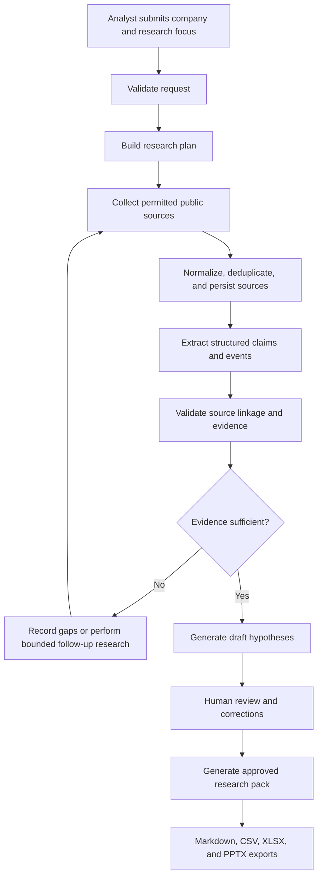

# PortfolioPulse — Step-by-Step Implementation Prompt for Coding Agents

> **Purpose:** Build PortfolioPulse, an evidence-first research workbench for analysing publicly available information about private-equity-backed companies. The product helps a human analyst organise sources, verify factual claims, generate cautious hypotheses, and export a consulting-style research pack.
>
> **How to use this document:** Give this entire file to your coding/orchestrator agent. Require it to implement one step at a time, run that step's verification commands, report the results, and only then continue. Do not accept a large untested implementation in one pass.

---

## 0. Product brief and non-negotiable rules

### Product objective

Given a company name, an official website, and a research focus, the application should:

1. Collect information from permitted public sources.
2. Preserve source URLs, timestamps, source metadata, and relevant evidence excerpts.
3. Extract structured factual claims and dated events.
4. Validate that claims are traceable to accessible sources and distinguish facts from interpretations.
5. Generate **preliminary hypotheses to investigate**, not unsupported claims about how a company is managed.
6. Allow a human analyst to approve, edit, or reject claims and hypotheses.
7. Export an analyst research pack: Markdown briefing, CSV files, an Excel workbook, and a concise PowerPoint deck.
8. Record enough run metadata to reproduce and debug research runs.

### Target user and intended use

The target user is a business analyst or consultant preparing an initial company research brief. The tool is a decision-support aid, not an autonomous consultant and not a substitute for interviews, company-internal information, proprietary benchmarks, or professional judgement.

### Hard rules

- **Evidence first.** Every material factual claim in the final briefing must link to one or more source records and include a short supporting excerpt or a clearly stated reason why the source does not directly support it.
- **Never invent.** Do not fabricate company facts, URLs, publication dates, quotations, financial figures, sources, or evaluation results. Mark unknown fields as `null` / `unknown` and report source gaps.
- **Separate fact from interpretation.** A verified fact is not the same as a hypothesis. Label hypotheses explicitly and include alternative explanations and questions for validation.
- **No unsupported diagnosis.** Public signals such as hiring patterns, acquisitions, or leadership changes must not be treated as proof of poor management, inefficiency, or a need to reduce staff.
- **Respect source access.** Do not bypass logins, paywalls, CAPTCHAs, rate limits, robots directives, or technical access controls. Do not scrape search-engine result pages. Use permitted sources, official APIs/RSS where available, or an explicitly configured search provider. Honour source terms and reasonable request limits.
- **Privacy and security.** Do not collect sensitive personal information. Store secrets only in environment variables. Never commit `.env` files, API keys, or credentials.
- **Human review.** Hypotheses and the first research pack must remain in draft/review state until a human approves the material. Never claim the report has been approved when it has not.
- **Deterministic where possible.** Use ordinary code for URL normalization, deduplication, date parsing, schema checks, exports, and database writes. Use LLM calls only when language understanding or synthesis is actually needed.
- **Provider-agnostic design.** Keep web search and LLM integrations behind interfaces. Prefer the providers already used in the repository. If none exist, create interfaces plus a reliable mock/fixture provider, and document how a real provider is configured. Do not block tests on API access.
- **No premature complexity.** Start with SQLite. Do not add vector databases, embeddings, a knowledge graph, Redis, distributed workers, or a fleet of autonomous agents unless the working MVP demonstrates a concrete need.
- **Do not overbuild.** Preserve existing repository conventions and working code. If this is an existing repo, inspect it first and make the smallest coherent changes. Do not replace the stack just because this document gives defaults.

### Suggested default stack for a new backend

Use these only if the repository does not already establish a stack:

- Python 3.12+ managed with `uv`
- FastAPI for the API
- Pydantic v2 for input and output schemas
- SQLAlchemy 2.x and SQLite for persistence
- LangGraph for orchestration
- `pytest` for tests
- `ruff` for linting and formatting checks
- `httpx` for HTTP requests and API tests
- `pandas` and/or Python's standard CSV utilities for data output
- `openpyxl` for Excel export
- `python-pptx` for PowerPoint export
- A Next.js / TypeScript interface only after the backend workflow is reliable, unless a frontend already exists

Keep dependencies lean. Pin or constrain dependencies appropriately and document the chosen versions.

---

## 1. How the coding/orchestrator agent must work

Follow this development loop for every step:

1. **Inspect** the current repository, relevant files, dependencies, conventions, and existing tests.
2. **State the scope** of the step in 3–6 bullets before editing.
3. **Implement only that step.** Avoid unrelated refactors.
4. **Add or update tests** alongside the implementation. Do not defer all tests until the end.
5. **Run verification commands** and inspect failures. Never claim a command passed unless it was actually executed and passed.
6. **Check regressions** in relevant existing functionality.
7. **Report the result** using the required progress report below.
8. Proceed to the next step only when the acceptance criteria pass. If blocked, fix the blocker or clearly report it; do not silently skip the gate.

### Required progress report after every step

```text
STEP: [number and name]
STATUS: PASS | BLOCKED | PARTIAL
CHANGES: [files added/modified and why]
TESTS RUN: [exact commands]
RESULTS: [pass/fail counts and important output]
MANUAL CHECK: [what was inspected and the result]
KNOWN LIMITATIONS: [honest list; use "None identified" only when appropriate]
NEXT STEP: [next step, or the blocker to resolve]
```

### Global implementation rules

- Keep each step reviewable and reasonably small.
- Avoid placeholder methods that return success without doing work.
- Do not silence exceptions broadly. Return useful errors and log safe diagnostic information.
- Do not use live websites or real model APIs in normal unit tests. Use fixtures and mocks; keep a separately marked optional smoke test for real providers.
- Never put secrets or full scraped pages into logs by default.
- Add timeouts, bounded retries, and request throttling to network operations.
- Make operations idempotent where practical. Re-running the same source should not duplicate the same source or claim unnecessarily.
- Use timezone-aware UTC timestamps internally; format them clearly in output.
- Ensure exports are reproducible from stored/reviewed records rather than being ephemeral text that cannot be traced back to evidence.
- Do not move on just because the app starts. Each step needs its defined tests and acceptance criteria.

---

## 2. End-to-end workflow and architecture

Implement this logical flow. The exact module layout may follow the repository's conventions, but the boundaries must remain clear.



### Important orchestration constraint

Use LangGraph to make state transitions, retry limits, branching, and review status explicit. Research branches may run in parallel when that improves performance, but they can be ordinary constrained nodes—not independent agents with unrestricted tools. Do not build parallelism before the single-company pipeline works end to end.

### Recommended initial graph nodes

1. `validate_request`
2. `plan_research`
3. `collect_sources`
4. `normalize_and_deduplicate`
5. `extract_claims`
6. `validate_claims`
7. `assess_evidence_gaps`
8. `generate_hypotheses`
9. `await_human_review` or a review-status transition in the API
10. `build_exports`
11. `finalize_run`

Every node must have typed inputs/outputs, clear errors, and tests. Bound retries and follow-up search rounds to avoid loops or unbounded spend.

---

# Implementation steps and gates

## Step 0 — Repository audit and implementation plan

### Build

Before coding, inspect the repository and report:

- Current language, framework, package manager, and application structure.
- Existing API routes, database setup, schema conventions, UI, and tests.
- Existing LLM/search provider integrations and environment variable names.
- Existing style/lint/test commands.
- Which pieces can be reused and which are genuinely missing.

If the repo is empty, propose a minimal structure before creating files. If it already has a working application, preserve its architecture unless there is a demonstrated problem.

### Verify

- Run the existing test suite and record its baseline status.
- Run the existing lint/type-check commands if present.
- Inspect configuration files and `.gitignore`.
- Confirm that no credentials are present in tracked files.

### Acceptance criteria

- A short repository audit exists in the agent's report.
- The agent has not made broad code changes before understanding the repo.
- Current failures are distinguished from new failures.

### Expected output

```text
Repository: [name/path]
Stack: [detected stack]
Existing tests: [pass/fail/not configured]
Reusable components: [list]
Missing components: [list]
Implementation plan: [ordered steps]
Risks/blockers: [list]
```

**Gate:** Do not start Step 1 until the audit is complete.

---

## Step 1 — Project foundation and configuration

### Build

Create or tidy the minimal project foundation:

- Application entry point and clear package/module structure.
- Central configuration loaded from environment variables.
- `.env.example` containing placeholder names only, never real secrets.
- `.gitignore` rules for `.env`, local databases, generated exports, caches, and build files where appropriate.
- Structured logging with run IDs; do not log secrets or full source contents by default.
- A consistent error-handling convention.
- Health-check endpoint if there is an API.

Suggested configuration fields (adjust to the repo):

```text
APP_ENV=development
DATABASE_URL=sqlite:///./portfoliopulse.db
SEARCH_PROVIDER=mock
LLM_PROVIDER=mock
MAX_SOURCES_PER_RUN=20
MAX_RESEARCH_ROUNDS=2
HTTP_TIMEOUT_SECONDS=15
MIN_REQUEST_INTERVAL_SECONDS=1
EXPORT_DIR=./artifacts
```

Do not add a secret value for any API key. Include optional provider key names in `.env.example` only when a real provider is actually implemented.

### Verify and test

- Test that application configuration loads with defaults.
- Test that environment variables override defaults.
- Test that invalid values (for example, a negative source limit) fail clearly.
- Test that importing the app does not start a research job or perform network calls.
- Run lint and the available unit test suite.

### Acceptance criteria

- A clean checkout can be configured using documented instructions.
- Missing optional API credentials do not break fixture-mode development.
- No real network request occurs just by importing the app or running unit tests.

### Expected output

A health endpoint response similar to:

```json
{
  "status": "ok",
  "service": "portfoliopulse",
  "environment": "development"
}
```

The exact schema may vary, but do not expose secret values, machine-specific paths, or other sensitive configuration in the response.

**Gate:** All configuration tests pass before continuing.

---

## Step 2 — Domain schemas and database persistence

### Build

Define validated schemas and persistence models for the central concepts. Prefer Pydantic schemas for application input/output and SQLAlchemy models for persisted records.

Minimum entities:

- `Company`
- `ResearchRun`
- `Source`
- `Claim`
- `Event` (or a clearly documented event classification on claims if a separate table is not justified)
- `Hypothesis`
- `Review`

Suggested field concepts:

**Company**
- ID, name, canonical website/domain, sector (optional), country/region (optional), created/updated timestamps.

**ResearchRun**
- ID, company ID, research focus, status, started/finished timestamps, error summary, configuration summary without secrets, counts for sources/claims/hypotheses.

**Source**
- ID, company/run association, URL, canonical URL, title, publisher/domain, source type, published date if available, retrieved timestamp, HTTP status if known, content hash, processing status, short excerpt or a reference to safely stored extracted text.

**Claim**
- ID, run/company/source association, claim text, category, supporting excerpt, date the claim concerns if known, extraction status, validation status, human review status, linked source ID(s).

**Event**
- ID, company ID, event type, event date if known, summary, source/claim references.

**Hypothesis**
- ID, run/company association, hypothesis text, supporting claim IDs, alternative explanations, missing evidence, suggested questions, status (`draft`, `approved`, `edited`, `rejected`).

**Review**
- ID, target type/ID, reviewer decision, reviewer notes, edited value if applicable, timestamp.

Use stable IDs, foreign-key constraints, appropriate indexes, and UTC-aware timestamps. Avoid storing large repeated page bodies in each row. Choose and document a retention approach for raw/extracted text. If using SQLite, consider its timezone limitations and normalise timestamps consistently.

### Verify and test

- Test schema validation for valid and invalid records.
- Test database create/read/update operations for each important entity.
- Test foreign-key constraints and missing linked-source cases.
- Test that a claim cannot be marked verified without linked evidence.
- Test persistence across a database session restart.
- Test idempotent source ingestion using a canonical URL and/or content hash.
- Test that database errors produce safe, useful messages.

### Acceptance criteria

- The database represents the evidence chain from company → run → source → claim → hypothesis/review.
- Claims and hypotheses can be traced to specific records.
- A source URL or fact is not silently invented to satisfy a required field.

### Expected output

A development seed or fixture database should contain a small fictional/test company, two sources, several claims, and one draft hypothesis. Example relationship:

```text
Company: Northstar Components (fixture only)
  └── ResearchRun: run_demo_001
      ├── Source: src_001 -> https://example.test/news/acquisition
      │   └── Claim: claim_001 -> "The company announced an acquisition."
      └── Hypothesis: hyp_001 -> status=draft
          └── Supporting claims: [claim_001]
```

Use `.test` / `.example` domains for fixtures and clearly label the data as fictional. Do not present this example as a real company or a real event.

**Gate:** Database round-trip, referential integrity, and deduplication tests pass.

---

## Step 3 — Source collection and source registry

### Build

Create a provider-agnostic collection layer. Include:

- A `SearchProvider` interface or protocol.
- A `PageFetcher` interface or protocol.
- A fixture/mock provider for deterministic tests and offline demos.
- At least one real provider only if its terms, credentials, and repository environment allow it; configure it through environment variables.
- Support for user-supplied official URLs even when no search API is configured.
- Canonical URL normalisation, domain/publisher extraction, retrieval timestamp, HTTP status, and content hash.
- Timeouts, a bounded retry policy, exponential backoff where appropriate, and per-domain throttling.
- Content-type and response-size limits, plus handling for redirects and inaccessible pages.
- A maximum number of sources and a maximum number of follow-up research rounds.
- Clear statuses for blocked, inaccessible, duplicate, unsupported content type, and successful fetches.

Do not scrape search result HTML or bypass access protections. Do not claim to support all websites. Start with a small, documented set of allowed public source types such as official company/investor pages, public filings, RSS feeds, and permitted news sources.

### Verify and test

Use local HTTP mocks or saved HTML fixtures to test:

- Successful HTML fetch.
- Redirect, 404, 403, timeout, server error, malformed URL, and unsupported content type.
- Oversized response rejection.
- Canonical URL normalisation and tracking-parameter handling.
- Duplicate URLs and duplicate content hashes.
- Rate limiting and bounded retries.
- Provider credential missing: the app should return an actionable message or use the documented fixture mode, not silently scrape a different site.
- No test should make an uncontrolled request to the live internet.

### Acceptance criteria

- Each collected source has provenance and a status, even if fetch fails.
- Failed sources are recorded as failures, not misrepresented as empty successful pages.
- Duplicate sources do not create repeated records without reason.
- The source limit and request limits are enforced.

### Expected output

Example source registry record (illustrative only):

```json
{
  "id": "src_demo_001",
  "url": "https://example.test/investors/news/acquisition",
  "canonical_url": "https://example.test/investors/news/acquisition",
  "title": "Acquisition announcement (fixture)",
  "publisher": "example.test",
  "source_type": "official_company_announcement",
  "published_at": null,
  "retrieved_at": "2026-10-20T10:00:00Z",
  "http_status": 200,
  "content_hash": "sha256:example-fixture-hash",
  "status": "fetched"
}
```

Use a real calculated hash in code. The hash above is illustrative, not a literal expected hash.

**Gate:** All network behaviour is mocked in automated tests, and failure states are covered.

---

## Step 4 — Structured extraction of facts and events

### Build

Create a structured extraction layer that consumes fetched source text and returns zero or more candidate claims. Use a provider interface for LLM-based extraction and a deterministic mock for tests.

For each candidate claim, capture:

- Stable claim ID.
- Exact claim text written in neutral language.
- Category, e.g. `company_profile`, `ownership`, `acquisition`, `strategy`, `leadership`, `hiring_signal`, `geographic_expansion`, `industry_context`.
- Supporting excerpt copied from the source (keep excerpts short).
- Source ID and URL.
- Relevant event date if explicitly supported, otherwise `null`.
- Confidence/status fields with defined semantics; do not confuse LLM self-confidence with verified truth.
- Verification status such as `unverified`, `supported`, `unsupported`, or `conflicting`.

Extract only facts that are relevant to the research focus. Preserve important qualifiers such as “plans to”, “expects to”, “announced”, “approximately”, and “according to the company”. Do not turn an intention into a completed event or a forecast into an actual result.

Validate every model response against a strict schema. If the response is invalid, perform at most one controlled repair attempt or mark that source as failed extraction. Do not silently coerce arbitrary free text into structured fields.

### Verify and test

Create fixtures containing:

- A clear announcement with a date.
- A page without a publication date.
- An aspirational statement about future growth.
- A source containing no useful facts.
- Contradictory statements across two sources.
- Malformed model output and missing required fields.
- Text that attempts to instruct the model to ignore the task or reveal secrets.
- Content with ambiguous dates and numbers.

Check that:

- Extracted facts have a source ID and supporting excerpt.
- Missing dates remain null instead of being guessed.
- Future plans remain future plans.
- The extractor does not treat page instructions as system instructions.
- Invalid structured output fails safely.

### Acceptance criteria

- Extraction results are structured, source-linked, and reviewable.
- No claim is labelled verified solely because a model emitted a high confidence score.
- Relevant contradictions remain visible rather than being collapsed into one guessed answer.

### Expected output

```json
{
  "id": "claim_demo_001",
  "category": "acquisition",
  "claim_text": "The company announced an acquisition of a regional distributor.",
  "source_ids": ["src_demo_001"],
  "supporting_excerpt": "[Short exact excerpt from the fictional test fixture.]",
  "event_date": null,
  "verification_status": "unverified",
  "human_review_status": "pending"
}
```

The excerpt must come from the actual fixture in the test; do not hard-code the explanatory placeholder above into a functioning extractor.

**Gate:** Schema validation and the extraction fixture suite pass.

---

## Step 5 — Evidence validation and contradiction handling

### Build

Implement a distinct validation stage before generating hypotheses. It should check:

1. The source record exists and is linked correctly.
2. The URL and retrieval metadata are present where available.
3. The supporting excerpt exists in the stored source content or verified extraction record.
4. The claim does not exceed what the excerpt says.
5. Publication date and event date are not confused.
6. Claims from different sources that disagree are flagged.
7. Every generated fact in a draft report has one or more linked claims.

Use deterministic checks for structural validity and linkage. An optional LLM entailment check may help identify unsupported claims, but it must be described as model-assisted and cannot be the sole guarantee of truth.

Add a contradiction representation, for example a validation issue with `issue_type=conflicting_claims`, linked claim IDs, descriptions, and review status. Do not decide which source is correct merely because one is newer or more authoritative; record the evidence and let the analyst decide when necessary.

### Verify and test

- Claim with valid excerpt and source linkage.
- Claim pointing to missing source.
- Claim with excerpt absent from the source record.
- Claim whose wording overstates the source.
- Two claims with conflicting figures or dates.
- Claims from official company material versus secondary reporting.
- A source URL that exists but does not support the factual claim.

Assert that the system reports the precise validation issue and does not mark invalid claims as verified.

### Acceptance criteria

- Structural checks are reproducible and covered by tests.
- Conflicts remain visible in the API and exports.
- The application never equates “URL reachable” with “claim supported”.

### Expected output

```json
{
  "claim_id": "claim_demo_002",
  "status": "needs_review",
  "issues": [
    {
      "type": "excerpt_not_found",
      "message": "The stored excerpt could not be matched to the source text."
    }
  ]
}
```

Exact issue types may vary, but they must be stable, documented, and useful to a user.

**Gate:** All validation tests pass, including at least one contradictory-source fixture.

---

## Step 6 — LangGraph orchestration

### Build

Only after Steps 1–5 work, connect the components into a LangGraph workflow. Keep node code small and testable outside the graph.

Recommended flow:

`validate_request -> plan_research -> collect_sources -> normalize_and_deduplicate -> extract_claims -> validate_claims -> assess_evidence_gaps -> generate_hypotheses -> review_pending -> exports_after_approval -> finalize_run`

Requirements:

- Use a typed state schema. State should contain the run ID, company ID, research focus, query plan, source IDs, claim IDs, validation issues, hypotheses, run status, bounded retry/round count, and output references.
- Persist intermediate results to the database so a process failure does not erase the full run.
- Keep graph nodes idempotent where possible.
- Use explicit status transitions and errors.
- Set maximum source and research-round limits.
- Ensure an inadequate-evidence path ends with a gap report or one bounded follow-up, not an infinite loop.
- Generate hypotheses only from evidence records that pass the required validation rules, with any exceptions explicitly flagged.
- Do not export a report as approved until review has been recorded.
- Parallelise independent research branches only after tests prove the sequential workflow works. Avoid spawning multiple agents for simple deterministic tasks.

### Verify and test

Use mock search and LLM providers. Test the full graph with a fixed fixture dataset:

- Happy path with several sources and claims.
- No sources found.
- Some sources fail while others succeed.
- Every candidate claim fails validation.
- Contradictory sources.
- LLM provider error.
- Reaching the maximum research rounds.
- Database error or interruption between stages.
- Retry/resume behaviour without duplicate sources/claims.
- Draft run cannot reach approved-export status without a review.

Capture node/status traces and confirm each test follows the expected path. Do not rely only on a test that checks “the graph returned a dictionary”.

### Acceptance criteria

- At least one end-to-end graph test passes without internet or paid API calls.
- Failure branches terminate safely and retain useful partial results.
- Run state and status can be inspected after completion or failure.

### Expected output

Example end-of-run status for a successful but unreviewed run:

```json
{
  "run_id": "run_demo_002",
  "status": "awaiting_review",
  "source_count": 8,
  "claim_count": 19,
  "supported_claim_count": 15,
  "claims_needing_review": 4,
  "hypothesis_count": 3,
  "exports": [],
  "warnings": ["Four claims need analyst review; no approved report has been generated."]
}
```

These figures are illustrative, not performance claims. Counts must come from persisted run results.

**Gate:** All graph happy-path and failure-path tests pass.

---

## Step 7 — Hypotheses that are useful but appropriately cautious

### Build

Generate a small number of preliminary hypotheses from reviewed or adequately supported claims. A hypothesis should include:

- Short title and explanation.
- Supporting claim IDs and source URLs.
- Evidence summary with the distinction between direct facts and interpretation.
- At least one plausible alternative explanation.
- Missing evidence required to test the hypothesis.
- Concrete questions a consultant could investigate in interviews, workshops, or further analysis.
- Status `draft` until reviewed by a human.

Example pattern:

- Observed facts: several acquisitions and entry into new regions.
- Possible hypothesis: the company may face increased operating-model coordination demands as it integrates acquisitions and expands geographically.
- Alternatives: the company may already have a central integration function; the acquisitions may operate independently by design; expansion may be small in scale.
- Questions: who owns integration decisions, what decisions are centralised, how are responsibilities assigned, and what indicators measure integration progress?

Do not generate definitive assessments such as “the organisation is inefficient” from these facts alone. Do not infer personal traits or sensitive information about named employees.

### Verify and test

- Hypothesis with valid supporting claims.
- Hypothesis with nonexistent claim IDs.
- Hypothesis without an alternative explanation.
- Hypothesis that phrases an inference as a proven fact.
- Hypothesis that recommends a decision unsupported by the evidence.
- Empty evidence set.

Add unit tests for schema requirements and prompt/model tests using a deterministic mock. If an LLM grader is used experimentally, it must not replace deterministic tests or human review.

### Acceptance criteria

- Each hypothesis has traceable supporting claims, alternatives, missing evidence, and questions.
- Hypotheses are labelled as preliminary and stay in draft status.
- The system gracefully returns “insufficient evidence to form a useful hypothesis” when appropriate.

### Expected output

```json
{
  "id": "hyp_demo_001",
  "title": "Potential integration complexity",
  "hypothesis_text": "The acquisition and geographic expansion activity may increase coordination demands across business units.",
  "supporting_claim_ids": ["claim_demo_001", "claim_demo_003"],
  "alternative_explanations": [
    "The company may already have a mature integration function.",
    "The acquired businesses may intentionally operate independently."
  ],
  "missing_evidence": [
    "Current operating model and decision rights",
    "Integration governance and performance measures"
  ],
  "questions_to_validate": [
    "Who owns cross-business integration decisions?",
    "How are responsibilities and reporting lines defined after acquisitions?"
  ],
  "status": "draft"
}
```

Use these exact illustrative values only in tests or documentation, never as research findings about a real company.

**Gate:** Hypothesis quality schema tests and unsafe-overstatement tests pass.

---

## Step 8 — Human review and approval workflow

### Build

Implement a minimal review interface, API, or CLI—whatever fits the repository—so an analyst can:

- Inspect a claim alongside its source, excerpt, publication/retrieval metadata, and validation issues.
- Approve a claim, edit its wording, reject it, or flag a conflict.
- Inspect a hypothesis and its supporting claims.
- Approve, edit, or reject a hypothesis with reviewer notes.
- See which items remain unresolved.
- Approve the report for export only after required review criteria are met.

Keep the first version simple. It may be an API plus a plain review page; a complex permissions system is not necessary for the MVP. However, every review action must be persisted with a timestamp and target record.

### Verify and test

- Approve, edit, and reject a claim.
- Approve, edit, and reject a hypothesis.
- Confirm edits persist and appear in subsequent reads/exports.
- Confirm rejected claims do not silently appear as established facts in the executive summary.
- Confirm draft/unreviewed material is visibly labelled.
- Confirm export approval is blocked when required review items are unresolved.
- Test invalid IDs and malformed review requests.

### Acceptance criteria

- Review decisions are persisted and auditable.
- Rejected or disputed material remains available in the audit trail but is excluded from approved conclusions unless explicitly disclosed as a conflict.
- No output is labelled approved without a persisted approval action.

### Expected output

Example review record:

```json
{
  "id": "review_demo_001",
  "target_type": "hypothesis",
  "target_id": "hyp_demo_001",
  "decision": "edited",
  "reviewer_notes": "Keep this as an investigation question, not a finding.",
  "created_at": "2026-10-20T10:30:00Z"
}
```

**Gate:** Review-state and export-permission tests pass.

---

## Step 9 — CSV, Excel, Markdown, and PowerPoint exports

### Build

Generate output from persisted records and the review state—not by asking the LLM to regenerate the whole report from memory.

#### A. Source register CSV

Suggested columns:

```text
source_id,company_name,title,publisher,source_type,url,published_at,retrieved_at,fetch_status,content_hash
```

#### B. Claim register CSV

Suggested columns:

```text
claim_id,company_name,category,claim_text,source_ids,source_urls,supporting_excerpt,event_date,verification_status,review_status,review_notes
```

#### C. Excel workbook

Suggested sheets:

1. `Executive Summary` — headline findings, important caveats, research date, review status.
2. `Company Profile` — known profile fields with sources.
3. `Events` — dated acquisitions, expansion announcements, leadership changes, and relevant developments.
4. `Evidence Register` — claims, evidence excerpts, source URLs, verification/review status.
5. `Hypotheses` — hypothesis, supporting claim IDs, alternatives, missing information, questions, status.
6. `Open Questions` — unresolved conflicts, evidence gaps, and suggested follow-up research.

Format dates consistently, freeze header rows, enable filters, set reasonable column widths, and keep the workbook readable. Do not make up numbers for charts or benchmark values. Use charts only when there is enough relevant data.

#### D. Markdown analyst briefing

Suggested sections:

1. Company and research scope.
2. Executive summary.
3. Company and ownership context.
4. Material public developments.
5. Evidence-backed observations.
6. Preliminary hypotheses to investigate.
7. Alternative explanations and limitations.
8. Open questions / recommended next research steps.
9. Sources and retrieval date.
10. Review and approval status.

Every factual statement in sections 2–5 must have a readable citation/footnote linking to a source in the evidence register. Label unsupported or disputed statements clearly; exclude them from approved conclusions where appropriate.

#### E. Five-slide PowerPoint deck

Slide 1 — Company and research scope.
Slide 2 — Company context and notable developments.
Slide 3 — Evidence-backed observations.
Slide 4 — Preliminary hypotheses and alternative explanations.
Slide 5 — Questions for validation, limitations, and next steps.

The deck must be readable, restrained, and suitable for a first-pass consulting discussion. Add source footnotes to slides containing facts. Do not create a dense deck filled with LLM-generated paragraphs.

### Verify and test

- Unit-test the required columns, sheet names, and report sections.
- Verify the export uses the latest persisted reviewer edits.
- Verify rejected claims are not presented as established facts.
- Verify source URLs are included and usable as links where supported.
- Verify output filenames are safe and avoid overwriting unrelated files.
- Test missing optional fields and non-ASCII characters.
- Open/read the generated XLSX and PPTX programmatically in tests where practical.
- Add a deterministic fixture export test, and compare stable parts of the output.
- Ensure an unapproved run creates draft outputs only if that behaviour is explicitly supported and clearly labelled; otherwise block exports until approval.

### Acceptance criteria

- All four export formats are generated from the same reviewed data snapshot.
- Output has no invented facts, placeholder text, broken source IDs, or confusing review status.
- Export failures are recorded and do not falsely mark the run complete.

### Expected output folder

```text
artifacts/
└── run_demo_002_northstar-components/
    ├── analyst_brief.md
    ├── sources.csv
    ├── claims.csv
    ├── research_pack.xlsx
    ├── research_brief.pptx
    └── manifest.json
```

Example manifest:

```json
{
  "run_id": "run_demo_002",
  "company_id": "company_demo_001",
  "generated_at": "2026-10-20T11:00:00Z",
  "approval_status": "approved",
  "files": [
    "analyst_brief.md",
    "sources.csv",
    "claims.csv",
    "research_pack.xlsx",
    "research_brief.pptx"
  ],
  "warnings": ["Two conflicting claims are disclosed in the Open Questions sheet."]
}
```

This manifest is an example of the format, not evidence that an export has actually been generated. Generate timestamps and statuses from the real run.

**Gate:** The fixture export suite passes and the generated files can be opened and inspected.

---

## Step 10 — API and minimal interface

### Build

If an API/UI is not already present, expose a small set of endpoints. Adjust names to the repo's conventions.

Suggested API:

```text
GET    /health
POST   /companies
GET    /companies/{company_id}
POST   /research-runs
GET    /research-runs/{run_id}
GET    /research-runs/{run_id}/sources
GET    /research-runs/{run_id}/claims
GET    /research-runs/{run_id}/hypotheses
POST   /claims/{claim_id}/review
POST   /hypotheses/{hypothesis_id}/review
POST   /research-runs/{run_id}/approve
POST   /research-runs/{run_id}/export
GET    /research-runs/{run_id}/exports
```

Use clear request/response schemas and validation. A research endpoint should return a run ID and current status; it should not block for an unexpectedly long time. For the MVP, a simple background task may be acceptable if it is reliable and documented. Do not add a distributed queue unless there is a real need.

If a frontend is in scope, implement only the key workflow:

1. Enter company and research focus.
2. See research run status and source counts.
3. Review claims with their evidence.
4. Review hypotheses.
5. Approve and download the research pack.

Prioritise evidence readability over animation, decorative dashboards, or an elaborate chat UI.

### Verify and test

- API tests for valid requests, invalid input, unknown IDs, and server errors.
- Test database state and API response agree.
- Test review endpoints change persisted statuses.
- Test request size limits and basic security properties.
- Ensure exceptions do not leak stack traces or environment values to users.
- For the UI, manually test the whole flow at desktop size and one narrow viewport.

### Acceptance criteria

- One user can run the research workflow from input through review and export without directly editing the database.
- Statuses and errors are understandable.
- The interface never hides source evidence behind an opaque AI summary.

### Expected output

Example run creation response:

```json
{
  "run_id": "run_demo_003",
  "status": "queued",
  "company": "Northstar Components (fixture)",
  "message": "Research run created. Poll the run endpoint for status."
}
```

Use `queued` only if the implementation really queues work; if processing is synchronous or uses another model, return the true state.

**Gate:** API integration tests pass; a complete happy path is manually verified.

---

## Step 11 — Evaluation, baseline comparison, and documentation

### Build

Create a small evaluation dataset of **10–15 companies from one industry**, using permitted public sources. The goal is to evaluate evidence collection and reporting, not to make claims about private internal organisational performance.

For an evaluation set of factual claims, manually annotate whether each claim is:

- Supported by the cited source.
- Partly supported or missing a key qualifier.
- Unsupported.
- Incorrect.
- Conflicting with another credible source.

Track at least:

- Claim support precision: supported extracted claims / all claims labelled as supported by the system.
- Citation relevance: whether the cited source directly supports the claim.
- Unsupported-claim rate in approved outputs.
- Missing/incorrect date rate.
- Duplicate source/event rate.
- End-to-end research time, including human verification.
- Human usefulness ratings for hypotheses and research questions.
- Cost per run if paid providers are used.

Set goals before measuring performance. Suggested initial targets—not guaranteed results—are:

- At least 90% precision for claims the system proposes as supported on the manually checked evaluation set.
- Every material factual statement in approved output has a source link.
- Zero known unsupported material claims in the final approved briefing after review.
- Measurable time savings on repeated tasks compared with a manual baseline, without reducing accuracy.
- A documented explanation for every failed target.

Do not tune and report results on the same examples without disclosure. Split development examples from held-out evaluation examples when practical. Report the dataset size and limitations alongside every metric.

### Documentation to produce

- `README.md`: product overview, setup, run instructions, configuration, tests, limitations, screenshots/examples.
- `.env.example`: placeholders only.
- `docs/architecture.md`: workflow and components.
- `docs/data-model.md`: key tables and relationships.
- `docs/evaluation.md`: dataset description, test procedure, metric definitions, actual results, limitations.
- `docs/source-policy.md`: permitted source categories, rate limits, and known limitations.
- Example outputs generated from explicitly fictional fixtures.

### Verify and test

- Run the full unit and integration suite.
- Run lint and type checks if configured.
- Run dependency/security checks available in the repo.
- Run the end-to-end workflow from a clean local setup using fixtures.
- Verify all documented commands work as written.
- Confirm the evaluation report contains measured results, not target numbers presented as achievements.
- Check repository status for accidental database files, generated artifacts, secrets, and unrelated changes.

### Acceptance criteria

- A new developer can follow the README and run a fixture demonstration.
- Evaluation numbers are reproducible and clearly separated from target metrics.
- Known limitations and unsupported cases are documented honestly.

### Expected final demonstration

A scripted or documented demo should:

1. Start with a named fictional company and a specific research question.
2. Run the workflow against saved HTML/source fixtures without network access.
3. Display source and claim counts plus validation warnings.
4. Show at least one source-backed claim, one hypothesis with alternatives, and one open evidence gap.
5. Demonstrate a human editing or rejecting an item.
6. Generate the reviewed output pack.
7. Open or inspect the Markdown, CSV, Excel, and PowerPoint files.
8. Show the automated test and evaluation commands and their actual results.

**Gate:** The repository is considered MVP-complete only when the final demo works from a clean environment and the full test suite passes.

---

# 3. Output quality contract

The final system should produce output with the following qualities.

## A. Example analyst brief structure

```markdown
# Company Research Brief: [Company Name]

**Research focus:** [Focus supplied by analyst]
**Prepared on:** [Actual date/time]
**Status:** Draft / Awaiting review / Approved
**Coverage:** [Number and types of sources reviewed]

## Executive summary
- [A concise, source-linked observation]
- [A concise, source-linked observation]
- [Important evidence gap or limitation]

## Company and ownership context
[Only supported facts, with source references.]

## Material developments
| Date | Development | Evidence | Source |
|---|---|---|---|
| [Date or Unknown] | [Neutral event description] | [Short excerpt/paraphrase] | [URL] |

## Evidence-backed observations
### Observation 1: [Neutral heading]
- **Fact:** [What the source supports]
- **Evidence:** [Excerpt or close paraphrase]
- **Source:** [Title, publisher, URL, date]
- **Limitations:** [What is not established]

## Preliminary hypotheses to investigate
### Hypothesis 1: [Cautious title]
- **Hypothesis:** [Possible implication, not a proven finding]
- **Supporting claims:** [Claim IDs and links]
- **Alternative explanations:** [Plausible alternatives]
- **Missing evidence:** [What would be needed to test it]
- **Questions:** [Specific questions for research/interviews]

## Conflicts and open questions
[Unresolved contradictions, missing data, and blocked sources.]

## Recommended next research steps
[Actions that gather evidence; no unsupported business prescription.]

## Method and limitations
[Source scope, date coverage, extraction limitations, human review status.]

## Sources
[Deduplicated list of relevant sources.]
```

The system must populate this structure with real run data. Bracketed placeholders are documentation only and must not appear in a finished deliverable.

## B. Data and reporting standards

- Use consistent date formats and timezone handling.
- Mark missing information explicitly as `Unknown` or `Not found in reviewed sources` rather than guessing.
- Separate source publication date, event date, and retrieval date.
- Cite material facts near where they appear, not only in a bibliography at the end.
- Show review status clearly.
- Include only relevant evidence. Do not confuse volume with quality.
- Use restrained, readable formatting suitable for a business audience.
- Do not state that PortfolioPulse has improved decision quality unless that outcome has actually been evaluated.

## C. Example API response for a completed draft run

```json
{
  "run_id": "run_demo_004",
  "status": "awaiting_review",
  "company": {
    "name": "Northstar Components",
    "website": "https://example.test"
  },
  "research_focus": "Acquisition integration and geographic expansion",
  "counts": {
    "sources_collected": 6,
    "claims_extracted": 14,
    "claims_supported": 10,
    "claims_needing_review": 4,
    "hypotheses_drafted": 2,
    "open_conflicts": 1
  },
  "limitations": [
    "Public sources do not establish the company's internal reporting lines.",
    "One reported event date conflicts across sources."
  ],
  "exports": [],
  "next_action": "Review unresolved claims and draft hypotheses before approving exports."
}
```

All names, URLs, and counts above are illustrative. In the application, use fixture-only test data or actual collected and persisted run data; never seed production output with these example findings.

---

# 4. Global test and release checklist

Before calling the MVP complete, verify every item below.

## Functionality

- [ ] A user can submit a company, official website, and research focus.
- [ ] Input validation rejects empty or malformed requests.
- [ ] The workflow operates fully in deterministic fixture mode.
- [ ] The system stores sources, claims, events, hypotheses, and reviews with correct links.
- [ ] Source duplicates are controlled and failures are visible.
- [ ] Claims can be traced to exact sources and excerpts.
- [ ] Conflicting evidence and missing information are represented explicitly.
- [ ] Hypotheses include alternatives, missing evidence, and follow-up questions.
- [ ] Human review is persisted and auditable.
- [ ] Exports accurately reflect the reviewed records.
- [ ] Failed runs preserve useful diagnostics and do not claim success.

## Quality and safety

- [ ] No unreviewed hypothesis is presented as a proven finding.
- [ ] No material factual claim is included in an approved brief without source support.
- [ ] No scraping control, paywall, login, CAPTCHA, or rate limit is bypassed.
- [ ] Network requests have timeouts and bounded retries.
- [ ] Secrets are not tracked, printed, or returned by the API.
- [ ] Untrusted page content is treated as data, not instructions.
- [ ] Input, request-size, source-count, and research-round limits are enforced.
- [ ] User-facing error messages are clear without exposing stack traces.

## Engineering

- [ ] Unit tests cover schemas, normalisation, validation, and export formatting.
- [ ] Integration tests cover database and API workflows.
- [ ] End-to-end tests cover success and critical failure paths.
- [ ] The full test suite passes from a clean setup.
- [ ] Lint/type checks pass, or documented existing failures are distinguished.
- [ ] README setup and test commands work as written.
- [ ] Fixture-mode demo requires no API credentials or live internet.
- [ ] Generated example outputs are inspected and contain no unresolved placeholders.

## Final report required from the coding agent

At the end, provide:

1. **What works:** implemented features, with links/paths to key files.
2. **Architecture:** a short explanation of the actual implemented data flow.
3. **Verification:** exact commands run and their true results.
4. **Demo:** exact commands to start the app and run the fixture demonstration.
5. **Example outputs:** paths to generated sample files, clearly labelled as fixture data if fictional.
6. **Evaluation:** actual measured results, dataset size, and limitations.
7. **Known issues:** anything incomplete, brittle, or not tested.
8. **Next three improvements:** ranked by user value, not technical novelty.

Do not say “all tests pass” if any relevant tests were not run. Do not claim real-provider integration if only mocks or fixtures are implemented.

---

# 5. Final instruction to the coding agent

Build PortfolioPulse as a dependable, evidence-first analyst tool—not as an agent demo designed to maximise the number of agents or libraries used.

**Priority order:** source traceability → reliable data model → claim validation → useful hypotheses → human review → clear business deliverables → UI polish.

Implement the steps sequentially. At the end of every step, stop and report its verification results using the required progress report. Fix failed gates before proceeding. When something cannot be implemented because a provider, credential, service, or external dependency is unavailable, create a clean interface and deterministic tests, document the limitation, and never fake a successful real integration.
